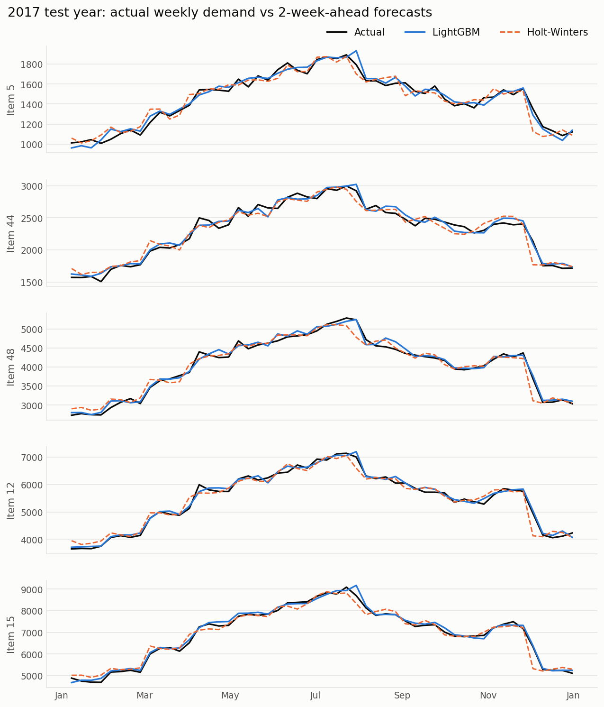
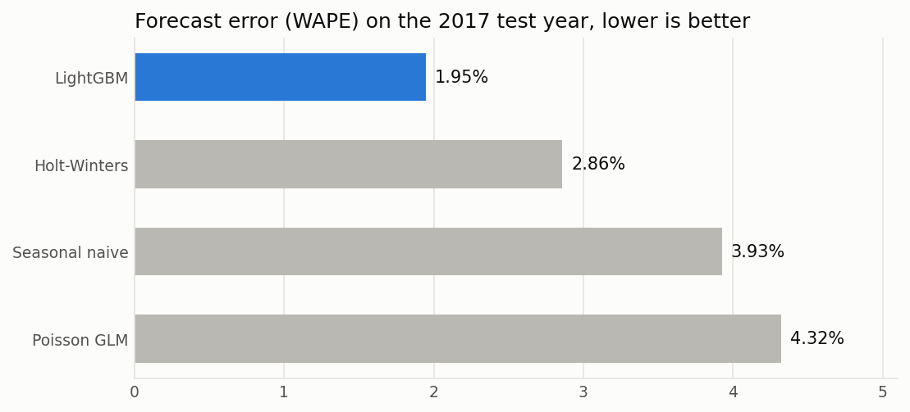
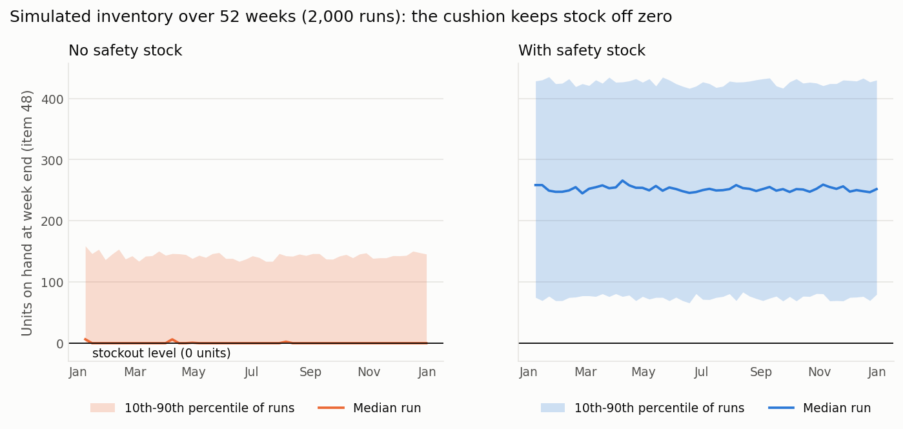
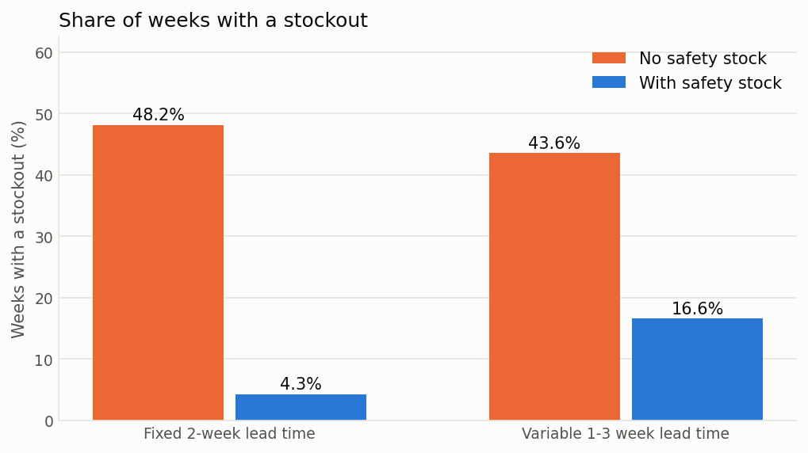

# Demand Forecasting & Inventory Planning Simulator

**Python · LightGBM · statsmodels · pandas · Monte Carlo simulation**

A production planner has to commit to orders before knowing what customers will buy, and suppliers take time to deliver. Forecast too low and the line runs short; forecast too high and cash sits on the shelf as stock.

This project forecasts weekly demand **two weeks ahead** (the supplier lead time), compares four forecasting methods on a year of data they never saw, and then uses simulation to decide **how much safety stock to hold** to meet a 95% service level.

## Headline results

- **More accurate forecasts.** The best model, LightGBM, misses **1.95%** of weekly volume, against 2.86% for the best classical method (Holt-Winters): about **32% less forecast error**. It was the most accurate model on all five products.
- **Far fewer stockouts for a modest cost.** With safety stock sized for a 95% service level, simulated weeks with a shortage fell from **48% to 4%**, and the share of demand met from stock rose from 98.6% to **99.9%**, for about **14% more average inventory**.
- **Supplier reliability matters more than forecast accuracy.** If the lead time varies between 1 and 3 weeks, the same plan runs short in 17% of weeks, and covering that risk takes roughly **9-14 times more safety stock**.

## Forecast accuracy

Average across 5 products, scored on 2017, a year held out from all model building. Every forecast is made two weeks ahead, and all models are refitted each week with the latest data.

| Model | WAPE | MAE (units/week) | MAPE | Bias |
|---|---|---|---|---|
| **LightGBM** (lag + calendar features) | **1.95%** | **70** | **1.98%** | +0.6% |
| Holt-Winters exponential smoothing | 2.86% | 107 | 3.01% | +0.1% |
| Seasonal naive (same week last year) | 3.93% | 156 | 3.98% | -3.8% |
| Poisson GLM (trend + yearly seasonality) | 4.32% | 175 | 4.48% | +3.2% |

- **WAPE** (weighted absolute percentage error) is the total forecast miss as a share of total demand. It is the headline metric because planners care about volume, and unlike MAPE it is not distorted by low-demand weeks.
- **Bias** is forecast minus actual as a share of demand: positive means over-forecasting.
- LightGBM's WAPE per product ranged from 1.4% to 2.5%.





## Inventory results

Each policy was simulated over 52 weeks, 2,000 times per product, with safety stock sized for a 95% service level. Figures are averages across the five products.

**Supplier lead time fixed at 2 weeks**

| | No safety stock | With safety stock |
|---|---|---|
| Weeks with a stockout | 48.2% | **4.3%** |
| Demand met from stock (fill rate) | 98.55% | **99.90%** |
| Average inventory | baseline | +13.7% |

**Lead time varies between 1 and 3 weeks, plan unchanged**

| | No safety stock | With safety stock |
|---|---|---|
| Weeks with a stockout | 43.6% | 16.6% |
| Demand met from stock (fill rate) | 87.44% | 89.21% |
| Average inventory | baseline | +9.2% |





**Service level vs inventory cost.** Each extra point of service costs more stock than the last.

| Target service level | Weeks with a stockout | Demand met | Average stock (weeks of demand) |
|---|---|---|---|
| 50% | 39.3% | 98.88% | 0.52 |
| 80% | 16.2% | 99.59% | 0.55 |
| 90% | 8.3% | 99.80% | 0.57 |
| **95%** | **4.3%** | **99.90%** | **0.59** |
| 99% | 0.9% | 99.98% | 0.62 |

Stockout rate and fill rate tell different stories. With no safety stock, about half of weeks are short, but each shortfall is small, so 98.6% of demand is still met. Which number matters depends on the cost of a shortage: for a material that stops a production line, even one short week is expensive.

## Approach

1. **Data.** [Kaggle Store Item Demand Forecasting Challenge](https://www.kaggle.com/c/demand-forecasting-kernels-only/data): daily sales of 50 items across 10 stores, 2013-2017. I chose five items spread from lowest to highest volume (IDs 5, 44, 48, 12, 15), summed them across stores, and aggregated to weekly demand, giving 260 complete weeks per item.
2. **Train/test split by date.** The first 208 weeks (2013-2016) are for model building; the final 52 weeks (2017) are used only for scoring. The split is never random, because a forecast must only use the past.
3. **Forecasting at the decision horizon.** The forecast for week *t* uses only data up to week *t* − 2, matching the 2-week supplier lead time.
   - *Seasonal naive* repeats the same week of last year.
   - *Holt-Winters* tracks a level, a trend and a yearly seasonal pattern, updating each as new data arrives.
   - *Poisson GLM* uses a log link with a time trend and yearly Fourier terms.
   - *LightGBM* uses demand lags of 2, 3, 4 and 52 weeks, an 8-week rolling mean, year-on-year growth and calendar features. It predicts demand relative to recent demand, because tree models cannot extrapolate growth.
4. **No data leakage.** Every feature is built from data at least two weeks old. A test overwrites recent and future weeks with junk values and confirms the features do not change. LightGBM's settings were chosen on a rolling backtest through 2016, before 2017 was scored.
5. **Safety stock by Monte Carlo.** I resampled each product's 2016 two-week-ahead forecast errors to simulate demand over the lead time 200,000 times, and set the reorder level at the 95th percentile. This was checked against the textbook formula (z × error standard deviation × √lead time); the simulation came out 17-33% higher, largely because it captures a small bias in the errors that the formula ignores.
6. **Inventory policy simulation.** Each week: receive deliveries, sell what is in stock (unmet demand is lost), then order up to forecast demand over the lead time plus safety stock.

## Limitations

- Public retail data stands in for manufacturing demand; one test year and five products is good evidence, not proof.
- The simulation resamples 52 forecast errors per product from 2016 rather than replaying real 2017 demand. 2016 errors were larger than 2017's, so the safety stock is on the cautious side.
- The ordering policy is deliberately simple: weekly review, lost sales, no minimum order quantities, capacity limits, shelf life or costs. "No safety stock" is a naive benchmark, not a realistic planner.
- The Poisson GLM has no holiday flags; its yearly seasonal terms stand in for them.

## What I learned

- **Match the forecast horizon to the decision.** Forecasting a full year ahead from one starting point, the simple seasonal naive beat Holt-Winters (3.9% vs 5.7% WAPE). Refitting weekly at the 2-week horizon reversed that.
- **Tree models need help with trends.** Predicting demand relative to its recent level, rather than raw units, let LightGBM handle growth it had never seen.
- **Service metrics need care.** Stockout rate and fill rate can tell very different stories about the same policy.
- **Lead-time reliability can outweigh forecast accuracy** when weekly volumes are large.

## How to run

```bash
git clone https://github.com/arakya/demand-forecasting-inventory-simulator.git
cd demand-forecasting-inventory-simulator
pip install -r requirements.txt     # on macOS, LightGBM also needs: brew install libomp
```

1. Download `train.csv` from the [Kaggle competition page](https://www.kaggle.com/c/demand-forecasting-kernels-only/data) (free account; accept the competition rules) and place it in `data/`. The data is not included in this repository.
2. Open `notebooks/demand_forecasting_inventory.ipynb` and run all cells. The weekly Holt-Winters and LightGBM refits take a few minutes.

## Repository structure

```
├── README.md
├── requirements.txt
├── notebooks/
│   └── demand_forecasting_inventory.ipynb   # full analysis
├── figures/                                 # charts used in this README
├── results/                                 # model comparison, safety stock and simulation tables
└── data/                                    # not committed: put Kaggle's train.csv here
```
